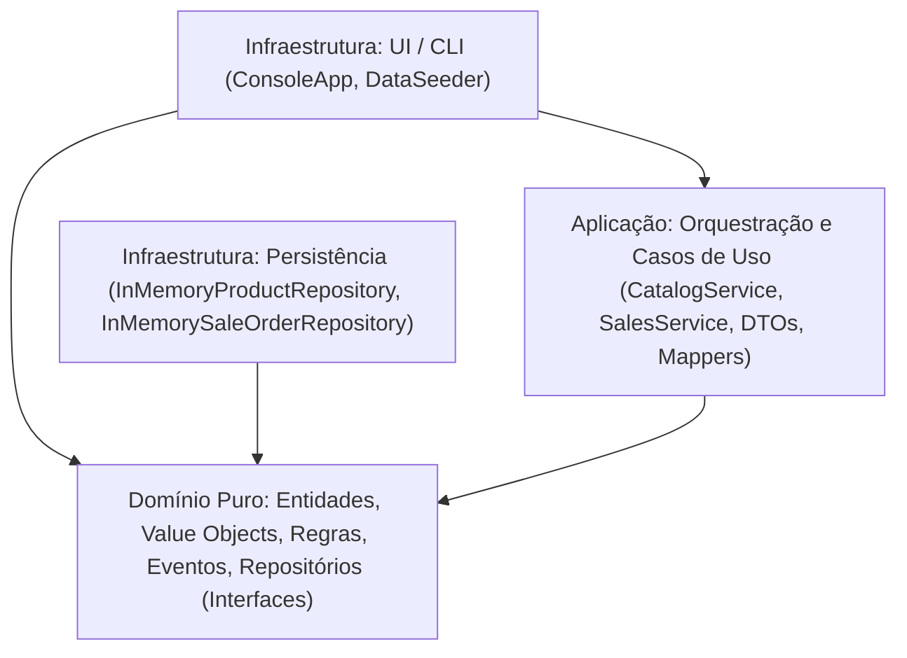
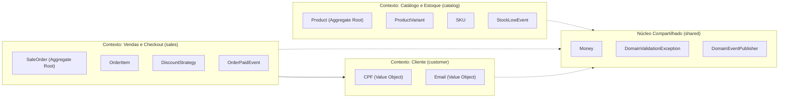

# 📐 Análise de Arquitetura: Por que este Projeto é Orientado ao Domínio (Domain-Driven Design)

Este documento detalha as razões técnicas, conceituais e arquiteturais pelas quais o presente projeto de **Gestão de Loja de Vestuário** é um exemplo fiel e canônico de **Domain-Driven Design (DDD)**, conforme preconizado por Eric Evans e Vaughn Vernon.

---

## 🧭 Sumário

1. [Visão Geral e Separação em Camadas](#1-visão-geral-e-separação-em-camadas)
2. [Linguagem Ubíqua (Ubiquitous Language)](#2-linguagem-ubíqua-ubiquitous-language)
3. [Contextos Delimitados (Bounded Contexts)](#3-contextos-delimitados-bounded-contexts)
4. [Agregados e Raízes de Agregação (Aggregates & Aggregate Roots)](#4-agregados-e-raízes-de-agregação)
5. [Entidades vs Objetos de Valor (Entities vs Value Objects)](#5-entidades-vs-objetos-de-valor)
6. [Modelo de Domínio Rico vs Modelo Anêmico](#6-modelo-de-domínio-rico-vs-modelo-anêmico)
7. [Repositórios Orientados a Domínio (Repository Pattern & DIP)](#7-repositórios-orientados-a-domínio)
8. [Padrão de Especificação (Specification Pattern)](#8-padrão-de-especificação)
9. [Políticas de Domínio (Domain Policies / Strategy Pattern)](#9-políticas-de-domínio)
10. [Eventos de Domínio (Domain Events & Decoupling)](#10-eventos-de-domínio)
11. [Orquestração na Camada de Aplicação (Application Services & DTOs)](#11-orquestração-na-camada-de-aplicação)
12. [Garantia Arquitetural Automatizada (ArchUnit)](#12-garantia-arquitetural-automatizada)

---

## 1. Visão Geral e Separação em Camadas

A base estrutural do DDD dita que a lógica central do negócio (o **Domínio**) deve ser o coração do software e deve ser **completamente isolada de preocupações técnicas**, como bancos de dados, frameworks web, interfaces de linha de comando ou bibliotecas externas.

O projeto adota a arquitetura em camadas (**Layered / Onion Architecture**):



- **Domínio Puro (`com.exemplo.domain`)**: Depende **exclusivamente** da biblioteca padrão do Java (`java.*`). Não contém anotações de frameworks (como Spring ou JPA), sem dependências de I/O, banco de dados ou CLI.
- **Aplicação (`com.exemplo.application`)**: Orquestra os fluxos dos casos de uso, converte dados para DTOs e despacha operações para o domínio.
- **Infraestrutura (`com.exemplo.infrastructure`)**: Implementa detalhes técnicos (repositórios em memória, interface interativa CLI).

---

## 2. Linguagem Ubíqua (Ubiquitous Language)

Em sistemas tradicionais orientados a dados (data-driven), encontramos termos técnicos genéricos como `ItemRecord`, `ProductManager`, `OrderData`, `status = 1`. 

No DDD, o vocabulário dos especialistas de negócio do varejo de moda está presente diretamente nos nomes de classes, métodos, atributos e exceções:

- **Peça e Classificação**: [`Product`](file:///G:/Meu%20Drive/ADS/3º%20Período%20IFPB/PP/ddd/dddexample/src/main/java/com/exemplo/domain/catalog/model/Product.java), [`ClothingCategory`](file:///G:/Meu%20Drive/ADS/3º%20Período%20IFPB/PP/ddd/dddexample/src/main/java/com/exemplo/domain/catalog/model/ClothingCategory.java) (`SHIRTS`, `DRESSES`, `PANTS`...).
- **Grade de Roupas**: [`ClothingSize`](file:///G:/Meu%20Drive/ADS/3º%20Período%20IFPB/PP/ddd/dddexample/src/main/java/com/exemplo/domain/catalog/model/ClothingSize.java) (suporta tamanhos alfabéticos `PP, P, M, G, GG, XG, UN` e numéricos de alfaiataria `36..52`).
- **Matriz de Variante**: [`ProductVariant`](file:///G:/Meu%20Drive/ADS/3º%20Período%20IFPB/PP/ddd/dddexample/src/main/java/com/exemplo/domain/catalog/model/ProductVariant.java), [`Color`](file:///G:/Meu%20Drive/ADS/3º%20Período%20IFPB/PP/ddd/dddexample/src/main/java/com/exemplo/domain/catalog/model/Color.java), [`SKU`](file:///G:/Meu%20Drive/ADS/3º%20Período%20IFPB/PP/ddd/dddexample/src/main/java/com/exemplo/domain/catalog/model/SKU.java), [`Barcode`](file:///G:/Meu%20Drive/ADS/3º%20Período%20IFPB/PP/ddd/dddexample/src/main/java/com/exemplo/domain/catalog/model/Barcode.java) (EAN-13/UPC).
- **Vendas e PDV**: [`SaleOrder`](file:///G:/Meu%20Drive/ADS/3º%20Período%20IFPB/PP/ddd/dddexample/src/main/java/com/exemplo/domain/sales/model/SaleOrder.java), [`OrderItem`](file:///G:/Meu%20Drive/ADS/3º%20Período%20IFPB/PP/ddd/dddexample/src/main/java/com/exemplo/domain/sales/model/OrderItem.java), [`OrderStatus`](file:///G:/Meu%20Drive/ADS/3º%20Período%20IFPB/PP/ddd/dddexample/src/main/java/com/exemplo/domain/sales/model/OrderStatus.java) (`DRAFT`, `CONFIRMED`, `PAID`, `CANCELLED`).
- **Políticas Comerciais**: Desconto por Volume (`VolumeDiscountStrategy`), Cupom Promocional (`PercentageDiscountStrategy`).
- **Operações Financeiras**: [`Money`](file:///G:/Meu%20Drive/ADS/3º%20Período%20IFPB/PP/ddd/dddexample/src/main/java/com/exemplo/domain/shared/Money.java), [`PaymentRecord`](file:///G:/Meu%20Drive/ADS/3º%20Período%20IFPB/PP/ddd/dddexample/src/main/java/com/exemplo/domain/sales/model/PaymentRecord.java), [`PaymentMethod`](file:///G:/Meu%20Drive/ADS/3º%20Período%20IFPB/PP/ddd/dddexample/src/main/java/com/exemplo/domain/sales/model/PaymentMethod.java) (`PIX`, `CREDIT_CARD`, `DEBIT_CARD`, `CASH`).

A linguagem ubíqua não é traduzida ou diluída: ela é o próprio código.

---

## 3. Contextos Delimitados (Bounded Contexts)

O sistema divide o domínio em contextos bem definidos, evitando modelos monolíticos e acoplados:



- **`catalog` (Catálogo & Estoque)**: Responsável pela definição das roupas, variantes (tamanho e cor), código de barras, níveis de estoque e alerta de reposição.
- **`sales` (Vendas & PDV)**: Responsável pelo ciclo de vida do pedido de compra, carrinho, aplicação de descontos promocionais, confirmação e registro de pagamento.
- **`customer` (Cliente)**: Responsável pela validação de dados cadastrais e fiscais do consumidor.
- **`shared` (Shared Kernel)**: Tipos fundamentais e barramento de eventos reutilizados pelos contextos delimitados.

---

## 4. Agregados e Raízes de Agregação (Aggregates & Aggregate Roots)

Um **Agregado** é um agrupamento de entidades e objetos de valor tratados como uma unidade atômica para fins de alteração de dados. A **Raiz do Agregado (Aggregate Root)** é o único ponto de entrada para qualquer mutação interna.

### Agregado `Product` (Catálogo)
- **Raiz**: [`Product`](file:///G:/Meu%20Drive/ADS/3º%20Período%20IFPB/PP/ddd/dddexample/src/main/java/com/exemplo/domain/catalog/model/Product.java)
- **Entidades Internas**: [`ProductVariant`](file:///G:/Meu%20Drive/ADS/3º%20Período%20IFPB/PP/ddd/dddexample/src/main/java/com/exemplo/domain/catalog/model/ProductVariant.java)
- **Proteção de Invariantes**:
  - Uma variante **nunca** é criada ou modificada diretamente de fora. Ela é adicionada através de `product.addVariant(...)` ou `product.replenishStock(...)`.
  - A raiz impõe que a combinação de `ClothingSize` e `Color` seja **única** dentro do mesmo produto.
  - A raiz protege as variantes retornando uma coleção imutável (`Collections.unmodifiableCollection(variants.values())`), impedindo alterações colaterais externas.

### Agregado `SaleOrder` (Vendas)
- **Raiz**: [`SaleOrder`](file:///G:/Meu%20Drive/ADS/3º%20Período%20IFPB/PP/ddd/dddexample/src/main/java/com/exemplo/domain/sales/model/SaleOrder.java)
- **Entidades e Objetos Internos**: [`OrderItem`](file:///G:/Meu%20Drive/ADS/3º%20Período%20IFPB/PP/ddd/dddexample/src/main/java/com/exemplo/domain/sales/model/OrderItem.java), [`PaymentRecord`](file:///G:/Meu%20Drive/ADS/3º%20Período%20IFPB/PP/ddd/dddexample/src/main/java/com/exemplo/domain/sales/model/PaymentRecord.java)
- **Proteção de Invariantes**:
  - Só é permitido adicionar ou remover itens se o pedido estiver no status `DRAFT`.
  - A confirmação (`order.confirm()`) exige no mínimo 1 item no pedido.
  - O pagamento (`order.pay(method, amountPaid)`) só pode ocorrer em pedidos `CONFIRMED` e rejeita qualquer quantia inferior ao valor total apurado.

---

## 5. Entidades vs Objetos de Valor (Entities vs Value Objects)

O projeto faz uma clara e rigorosa diferenciação entre Entidades e Objetos de Valor:

| Conceito | Tipo | Papel no Domínio |
| :--- | :--- | :--- |
| [`Product`](file:///G:/Meu%20Drive/ADS/3º%20Período%20IFPB/PP/ddd/dddexample/src/main/java/com/exemplo/domain/catalog/model/Product.java) | **Entidade** | Possui identidade contínua representada por [`ProductId`](file:///G:/Meu%20Drive/ADS/3º%20Período%20IFPB/PP/ddd/dddexample/src/main/java/com/exemplo/domain/catalog/model/ProductId.java). Dois produtos com mesmo nome são distintos se seus IDs forem diferentes. |
| [`SaleOrder`](file:///G:/Meu%20Drive/ADS/3º%20Período%20IFPB/PP/ddd/dddexample/src/main/java/com/exemplo/domain/sales/model/SaleOrder.java) | **Entidade** | Possui identidade contínua via [`OrderId`](file:///G:/Meu%20Drive/ADS/3º%20Período%20IFPB/PP/ddd/dddexample/src/main/java/com/exemplo/domain/sales/model/OrderId.java) e ciclo de vida dinâmico. |
| [`Money`](file:///G:/Meu%20Drive/ADS/3º%20Período%20IFPB/PP/ddd/dddexample/src/main/java/com/exemplo/domain/shared/Money.java) | **Value Object** | Imutável, sem identidade própria. Dois objetos com `R$ 150,00` são indistinguíveis. Encapsula `BigDecimal` com arredondamento monetário bancário (`HALF_EVEN`). Métodos `add()`, `subtract()`, `multiply()` retornam novas instâncias. |
| [`CPF`](file:///G:/Meu%20Drive/ADS/3º%20Período%20IFPB/PP/ddd/dddexample/src/main/java/com/exemplo/domain/customer/model/CPF.java) | **Value Object** | Auto-validável. Rejeita números com formato inválido, CPFs com dígitos repetidos ("11111111111") ou com dígitos verificadores matematicamente incorretos. |
| [`Email`](file:///G:/Meu%20Drive/ADS/3º%20Período%20IFPB/PP/ddd/dddexample/src/main/java/com/exemplo/domain/customer/model/Email.java) | **Value Object** | Garante sintaxe válida de correio eletrônico em tempo de construção. |
| [`SKU`](file:///G:/Meu%20Drive/ADS/3º%20Período%20IFPB/PP/ddd/dddexample/src/main/java/com/exemplo/domain/catalog/model/SKU.java) | **Value Object** | Formato canônico de Stock Keeping Unit gerado deterministicamente a partir da marca, nome, cor e tamanho da peça (ex: `DUCAMPOLBLUM`). |
| [`Barcode`](file:///G:/Meu%20Drive/ADS/3º%20Período%20IFPB/PP/ddd/dddexample/src/main/java/com/exemplo/domain/catalog/model/Barcode.java) | **Value Object** | Representa códigos de barras válidos (EAN-13, EAN-8, UPC). |
| [`ClothingSize`](file:///G:/Meu%20Drive/ADS/3º%20Período%20IFPB/PP/ddd/dddexample/src/main/java/com/exemplo/domain/catalog/model/ClothingSize.java) | **Value Object** | Representação segura da grade de tamanhos têxteis. |
| [`ProductId`](file:///G:/Meu%20Drive/ADS/3º%20Período%20IFPB/PP/ddd/dddexample/src/main/java/com/exemplo/domain/catalog/model/ProductId.java) / [`OrderId`](file:///G:/Meu%20Drive/ADS/3º%20Período%20IFPB/PP/ddd/dddexample/src/main/java/com/exemplo/domain/sales/model/OrderId.java) | **Value Object** | **Strongly Typed IDs**. Evita o anti-pattern *Primitive Obsession* (usar simples `String` ou `Long` para IDs, o que permite passar acidentalmente o ID de um produto num método que espera o ID de um pedido). |

---

## 6. Modelo de Domínio Rico vs Modelo Anêmico

Em sistemas com **Modelo Anêmico** (anti-pattern clássico), as classes de domínio são apenas DTOs com getters e setters vazios, enquanto toda a lógica de negócio fica espalhada em controllers ou "managers".

Neste projeto, o **Modelo é Rico**:
- A entidade **se defende**: o construtor e os métodos rejeitam qualquer estado inválido lançando [`DomainValidationException`](file:///G:/Meu%20Drive/ADS/3º%20Período%20IFPB/PP/ddd/dddexample/src/main/java/com/exemplo/domain/shared/DomainValidationException.java).
- Cálculos financeiros, deduções de estoque e validações de regras de negócio residem **dentro** das próprias entidades e agregados:
  - [`SaleOrder.calculateSubtotal()`](file:///G:/Meu%20Drive/ADS/3º%20Período%20IFPB/PP/ddd/dddexample/src/main/java/com/exemplo/domain/sales/model/SaleOrder.java#L95)
  - [`SaleOrder.calculateDiscount()`](file:///G:/Meu%20Drive/ADS/3º%20Período%20IFPB/PP/ddd/dddexample/src/main/java/com/exemplo/domain/sales/model/SaleOrder.java#L103)
  - [`SaleOrder.calculateTotal()`](file:///G:/Meu%20Drive/ADS/3º%20Período%20IFPB/PP/ddd/dddexample/src/main/java/com/exemplo/domain/sales/model/SaleOrder.java#L116)
  - [`ProductVariant.deductStock(quantity)`](file:///G:/Meu%20Drive/ADS/3º%20Período%20IFPB/PP/ddd/dddexample/src/main/java/com/exemplo/domain/catalog/model/ProductVariant.java#L78) (lança exceção caso a quantidade requisitada supere o saldo atual).

---

## 7. Repositórios Orientados a Domínio (Repository Pattern & DIP)

O DDD determina que o repositório é uma ilusão de uma coleção em memória de raízes de agregação.

O projeto aplica o **Princípio da Inversão de Dependência (DIP)**:
1. **Contrato no Domínio**: As interfaces [`ProductRepository`](file:///G:/Meu%20Drive/ADS/3º%20Período%20IFPB/PP/ddd/dddexample/src/main/java/com/exemplo/domain/catalog/repository/ProductRepository.java) e [`SaleOrderRepository`](file:///G:/Meu%20Drive/ADS/3º%20Período%20IFPB/PP/ddd/dddexample/src/main/java/com/exemplo/domain/sales/repository/SaleOrderRepository.java) residem dentro dos pacotes do domínio.
2. **Implementação na Infraestrutura**: As classes concretas [`InMemoryProductRepository`](file:///G:/Meu%20Drive/ADS/3º%20Período%20IFPB/PP/ddd/dddexample/src/main/java/com/exemplo/infrastructure/persistence/InMemoryProductRepository.java) e [`InMemorySaleOrderRepository`](file:///G:/Meu%20Drive/ADS/3º%20Período%20IFPB/PP/ddd/dddexample/src/main/java/com/exemplo/infrastructure/persistence/InMemorySaleOrderRepository.java) residem na camada de infraestrutura.
3. Se amanhã o banco de dados for trocado por PostgreSQL, MongoDB ou DynamoDB, **nenhuma linha do domínio ou da aplicação precisará ser alterada**.

---

## 8. Padrão de Especificação (Specification Pattern)

No DDD, regras de seleção ou predicados de validação complexos de negócio são desacoplados usando o padrão **Specification**.

Em [`ProductSpecification`](file:///G:/Meu%20Drive/ADS/3º%20Período%20IFPB/PP/ddd/dddexample/src/main/java/com/exemplo/domain/catalog/specification/ProductSpecification.java), as especificações são combináveis funcionalmente:
```java
ProductSpecification spec = new InStockSpecification()
    .and(new ByCategorySpecification(ClothingCategory.SHIRTS))
    .and(new MaxPriceSpecification(Money.of(250.0)));

boolean elegivel = spec.isSatisfiedBy(produto);
```
Isso permite expressar critérios de negócio reutilizáveis e legíveis sem poluir repositórios com queries ad-hoc.

---

## 9. Políticas de Domínio (Domain Policies / Strategy Pattern)

Regras de negócio que variam conforme o contexto comercial (como cálculo de descontos) são tratadas como **Políticas de Domínio (Domain Policies)**:

- Contrato: [`DiscountStrategy`](file:///G:/Meu%20Drive/ADS/3º%20Período%20IFPB/PP/ddd/dddexample/src/main/java/com/exemplo/domain/sales/policy/DiscountStrategy.java)
- Implementações:
  - [`NoDiscountStrategy`](file:///G:/Meu%20Drive/ADS/3º%20Período%20IFPB/PP/ddd/dddexample/src/main/java/com/exemplo/domain/sales/policy/NoDiscountStrategy.java): Política padrão (zero desconto).
  - [`PercentageDiscountStrategy`](file:///G:/Meu%20Drive/ADS/3º%20Período%20IFPB/PP/ddd/dddexample/src/main/java/com/exemplo/domain/sales/policy/PercentageDiscountStrategy.java): Cupons promocionais de percentual fixo.
  - [`VolumeDiscountStrategy`](file:///G:/Meu%20Drive/ADS/3º%20Período%20IFPB/PP/ddd/dddexample/src/main/java/com/exemplo/domain/sales/policy/VolumeDiscountStrategy.java): Desconto por quantidade de peças (ex: compre 3 ou mais e ganhe 15% de desconto).

A política recebe a raiz do agregado (`SaleOrder`) e calcula o desconto com base no subtotal e na quantidade de itens, garantindo que novas regras de promoção possam ser adicionadas sem alterar o pedido.

---

## 10. Eventos de Domínio (Domain Events & Decoupling)

Eventos de Domínio capturam fatos que ocorreram no negócio e que são de interesse de outros componentes ou contextos:

- [`DomainEvent`](file:///G:/Meu%20Drive/ADS/3º%20Período%20IFPB/PP/ddd/dddexample/src/main/java/com/exemplo/domain/shared/event/DomainEvent.java): Interface base imutável contendo timestamp `occurredAt()`.
- [`StockLowEvent`](file:///G:/Meu%20Drive/ADS/3º%20Período%20IFPB/PP/ddd/dddexample/src/main/java/com/exemplo/domain/catalog/event/StockLowEvent.java): Disparado quando uma baixa de estoque atinge ou fica abaixo do limite de segurança (`minStockThreshold`).
- [`OrderPaidEvent`](file:///G:/Meu%20Drive/ADS/3º%20Período%20IFPB/PP/ddd/dddexample/src/main/java/com/exemplo/domain/sales/event/OrderPaidEvent.java): Disparado no checkout ao liquidar o pagamento com sucesso.
- Barramento: [`DomainEventPublisher`](file:///G:/Meu%20Drive/ADS/3º%20Período%20IFPB/PP/ddd/dddexample/src/main/java/com/exemplo/domain/shared/event/DomainEventPublisher.java) permite assinantes (subscribers) reagirem de forma desacoplada aos eventos ocorridos.

---

## 11. Orquestração na Camada de Aplicação (Application Services & DTOs)

Os serviços de aplicação ([`CatalogService`](file:///G:/Meu%20Drive/ADS/3º%20Período%20IFPB/PP/ddd/dddexample/src/main/java/com/exemplo/application/catalog/CatalogService.java) e [`SalesService`](file:///G:/Meu%20Drive/ADS/3º%20Período%20IFPB/PP/ddd/dddexample/src/main/java/com/exemplo/application/sales/SalesService.java)) têm papel estrito de **orquestradores de casos de uso**:

1. Recuperam o agregado do repositório.
2. Delegam a operação para o método de negócio da raiz do agregado.
3. Persistem a alteração no repositório.
4. Mapeiam entidades para DTOs de saída via [`CatalogMapper`](file:///G:/Meu%20Drive/ADS/3º%20Período%20IFPB/PP/ddd/dddexample/src/main/java/com/exemplo/application/dto/CatalogMapper.java) e [`SalesMapper`](file:///G:/Meu%20Drive/ADS/3º%20Período%20IFPB/PP/ddd/dddexample/src/main/java/com/exemplo/application/dto/SalesMapper.java).

**Importante**: As entidades de domínio **nunca** vazam diretamente para a camada de apresentação (`UI/CLI`). Toda comunicação externa ocorre através de DTOs imutáveis (`Java Records`: [`ProductDTO`](file:///G:/Meu%20Drive/ADS/3º%20Período%20IFPB/PP/ddd/dddexample/src/main/java/com/exemplo/application/dto/ProductDTO.java), [`OrderDTO`](file:///G:/Meu%20Drive/ADS/3º%20Período%20IFPB/PP/ddd/dddexample/src/main/java/com/exemplo/application/dto/OrderDTO.java), etc.).

---

## 12. Garantia Arquitetural Automatizada (ArchUnit)

Para garantir que a integridade do DDD não seja violada durante a evolução do software, o projeto possui testes arquiteturais automatizados em [`ArchitectureTest.java`](file:///G:/Meu%20Drive/ADS/3º%20Período%20IFPB/PP/ddd/dddexample/src/test/java/com/exemplo/architecture/ArchitectureTest.java), executados pelo **ArchUnit**:

```java
// O Domínio não pode depender de Aplicação nem de Infraestrutura
@ArchTest
public static final ArchRule domainMustNotDependOnApplicationOrInfrastructure =
        classes()
                .that().resideInAPackage("..domain..")
                .should().onlyDependOnClassesThat()
                .resideInAnyPackage("..domain..", "java..");

// A Aplicação não pode depender de Infraestrutura
@ArchTest
public static final ArchRule applicationMustNotDependOnInfrastructure =
        classes()
                .that().resideInAPackage("..application..")
                .should().onlyDependOnClassesThat()
                .resideInAnyPackage("..application..", "..domain..", "java..");

// Validação formal da arquitetura em camadas
@ArchTest
public static final ArchRule verifyLayeredArchitecture =
        layeredArchitecture()
                .consideringAllDependencies()
                .layer("Domain").definedBy("..domain..")
                .layer("Application").definedBy("..application..")
                .layer("Infrastructure").definedBy("..infrastructure..")
                .layer("Boot").definedBy("com.exemplo")
                .whereLayer("Domain").mayOnlyBeAccessedByLayers("Application", "Infrastructure", "Boot")
                .whereLayer("Application").mayOnlyBeAccessedByLayers("Infrastructure", "Boot")
                .whereLayer("Infrastructure").mayOnlyBeAccessedByLayers("Boot");
```

Essas regras são avaliadas a cada execução de `mvn test`, impedindo que acoplamentos indevidos entrem no código.

---

## 🏁 Conclusão

O projeto é legitimamente **Domain-Driven** porque:
1. **O Domínio é soberano**: Todas as decisões de negócio e integridade residem em objetos de domínio ricos, livres de dependências técnicas.
2. **Vocabulário do Negócio**: Do código de barras e tamanho de roupa às políticas de desconto e fechamento de caixa, o código reflete fielmente o mundo real de uma loja de roupas.
3. **Padrões Táticos Completos**: Implementa Agregados, Raízes de Agregação, Entidades, Value Objects, Strongly Typed IDs, Repositórios com Inversão de Dependência, Especificações, Políticas e Eventos de Domínio.
4. **Proteção Contínua**: O isolamento entre as camadas é verificado matematicamente por testes estáticos de arquitetura via ArchUnit.
